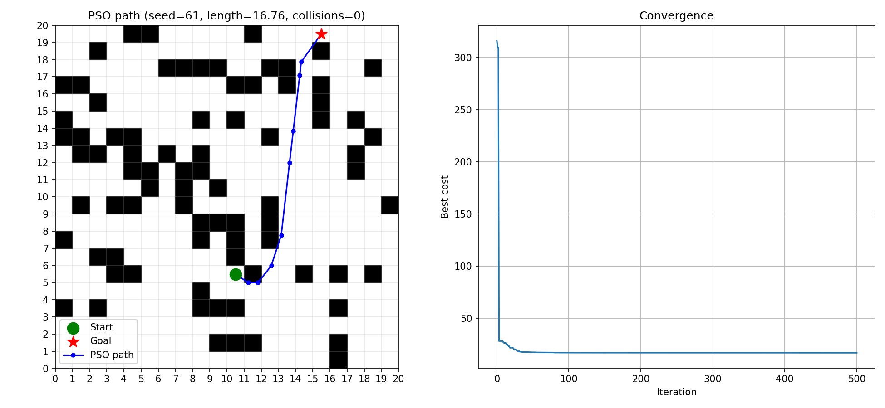

# Swarm-Based Path Planning with PSO

- **Name:** YOUR NAME HERE
- **Roll number:** 061
- **Seed used:** `61` (`SEED = 61` in `pso_path.py`)

## Approach
1. The problem is generated from the seed: a 20x20 grid, 20% random obstacles, and random start/goal cells (on free cells, far apart, and checked by BFS so a path exists).
2. Each PSO particle is a candidate path: 8 waypoints (x, y) between the start and goal.
3. Cost = path length + 30 x (number of sample points that fall inside an obstacle). A collision-free path therefore has cost equal to its length.
4. Particles update velocity and position with the standard PSO rule (w=0.7, c1=c2=1.5), tracking personal best and global best.
5. After 400 iterations the global best path is printed and plotted.

## How to run
```bash
pip install -r requirements.txt
python pso_path.py
```
Output: best path, length, collisions in the terminal, plus `result.png` (grid + path + convergence curve).

## Result


## Hand-drawn flow diagram

